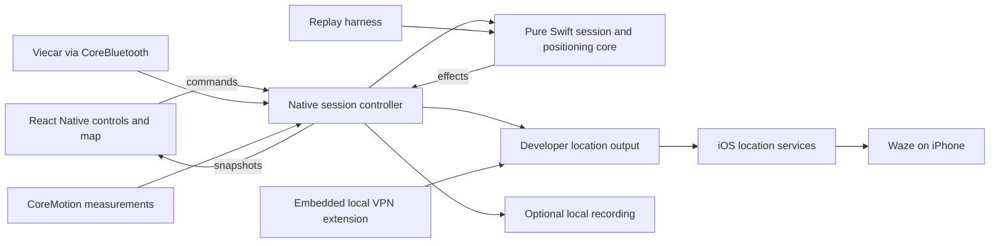

# System design

## Responsibility and proof boundaries

The product is an experimental system-location supplier. Waze owns destination choice, routing, and navigation presentation. NavBridge estimates position and controls whether it supplies coordinates to iOS. The owner-reported Waze observation does not prove every location consumer or CarPlay configuration follows those coordinates.

The tunnel enables the developer connection. It does not grant arbitrary execution to the main application, expose OBD data, or make the JS runtime a suitable sensor clock. All live control and timing stays native. There is no backend in the baseline.

## Ownership

| Responsibility | Owner | Why |
|---|---|---|
| Editable coordinate/heading draft and layout | React feature | Changes are not live until confirmed |
| Session identity, resources, cancellation, errors | Native session controller | Must survive screen unmount and JS delays |
| Deterministic transitions, units, geometry | Pure Swift core | Same code must run under replay |
| BLE packets and IMU samples | Native OS integration | Preserve timing, framing, and device metadata |
| Confirmed position/heading and estimator state | Pure core within active native session | One authoritative value, not mirrored JS state |
| VPN extension lifecycle | iOS Network Extension plus app manager | Separate signed extension process |
| Pairing and location-simulation handles | Native location-output module | Scope credentials and ordered set/clear operations |
| Diagnostics and recording policy | Native recording boundary | Bounded data and explicit user export |

## Design decisions and alternatives

Chosen proposal: native calculation and orchestration with React Native presentation. A JS-only loop is simpler initially but does not establish correct background timing. A wholly SwiftUI application would avoid the RN bridge but would contradict the owner's selected stack. Reusing a narrow Locus/idevice mechanism preserves the tested approach; a production-grade public location-provider API is not currently established.

The integrated VPN design is desired, pending signing and own-build feasibility. External LocalDevVPN is a comparison/control configuration for experiments, not an automatically accepted final dependency. No purchased MFi hardware or undocumented vehicle CAN commands are part of the baseline.

## Source separation

Once injection begins, Core Location can report our own output. Tag all observations by origin and reject injected, unknown, or stale system positions as independent corrections. An independent reference for field assessment must be recorded without this feedback path. A pre-session trusted observation can be retained with its provenance; it does not become continuously trusted.

## Operational invariants

- Never integrate across an unobserved long gap or infer missing speed as zero.
- Generation changes invalidate earlier sensor callbacks and queued output.
- Only one location-output effect is outstanding; correction and Stop supersede old work.
- Establish data quality before active output. No automatic blind restart after reconnect.
- A successful UI command means a defined native result, not merely a button press.
- Clear is attempted before closing its transport. A failed/unknown clear remains visible.
- Restart recovery examines outstanding output state before accepting Start.
- Neither VPN availability nor a background mode proves continuous BLE/IMU execution; device measurements are required.

## Change boundaries

The baseline adds a new RN feature, a narrow native interface, a pure Swift core, and OS integrations. Existing template registration, CocoaPods behavior, and signing must remain functional. Preserve the Android template without claiming product support. Avoid unrelated framework migrations or dependency upgrades.
